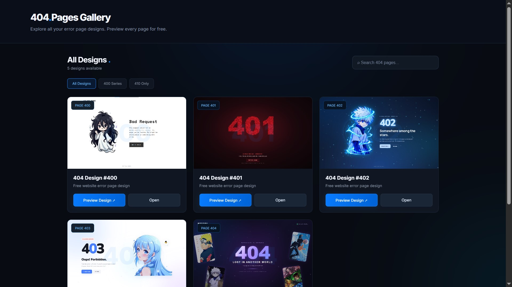
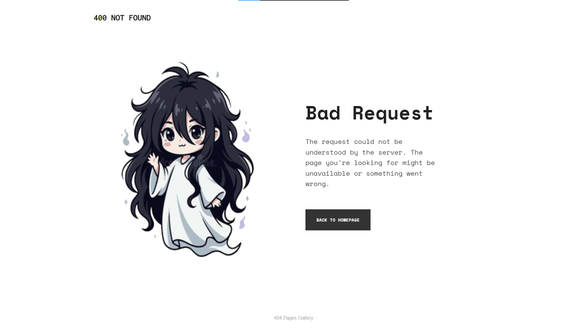
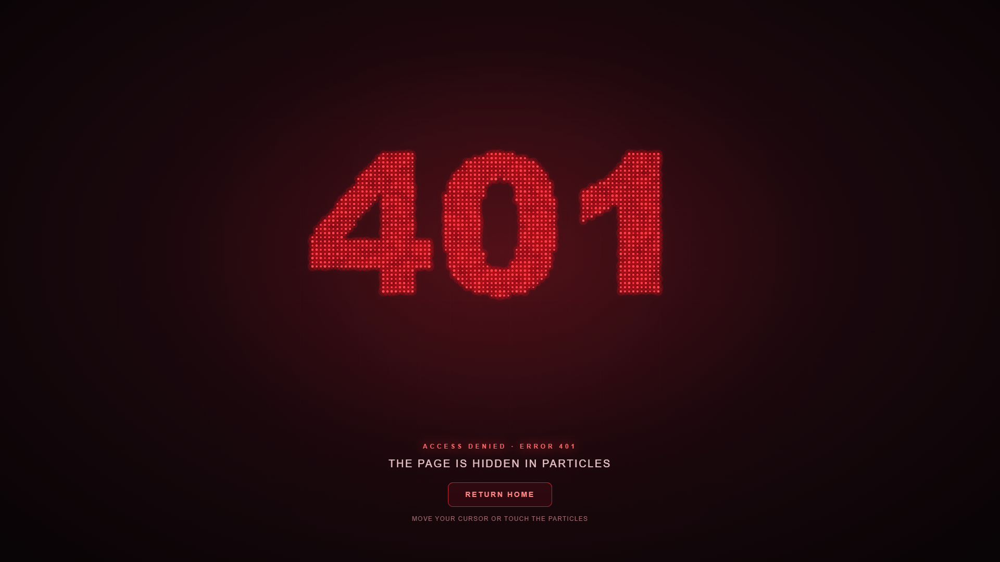
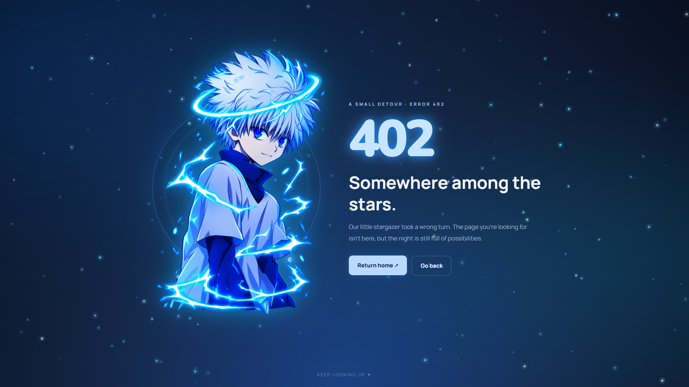
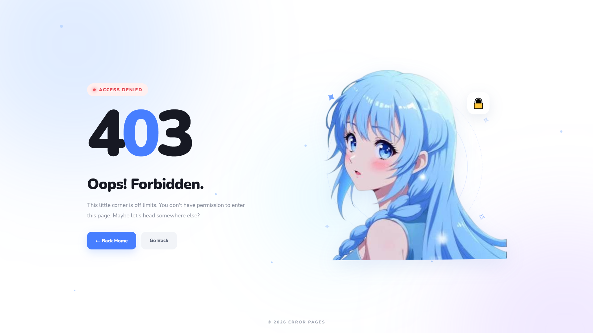

# 404 Pages Gallery

<p align="center">
  
</p>

<p align="center">
  <a href="https://zrong-me.github.io/404-Pages/"><strong>🌐 Visit Live Gallery</strong></a>
  ·
  <a href="https://github.com/zrong-me/404-Pages"><strong>⭐ GitHub Repository</strong></a>
</p>

A collection of creative and animated error pages built with HTML, CSS, and JavaScript. Explore the designs, preview them, and use the source code in your own projects.

## ✨ Features

- Five individual page designs (400–404)
- Animated designs and visual effects
- Live preview inside the gallery
- Search and filter pages
- Open individual pages in a new tab
- Responsive layout for desktop, tablet, and mobile
- Lightweight — no build tools required

## 🖼️ Page Gallery

| Page | Preview | Source |
|---|---|---|
| **400** | [](page/400/400.html) | [Open 400](page/400/400.html) |
| **401** | [](page/401/401.html) | [Open 401](page/401/401.html) |
| **402** | [](page/402/402.html) | [Open 402](page/402/402.html) |
| **403** | [](page/403/403.html) | [Open 403](page/403/403.html) |
| **404** | [](page/404/404.html) | [Open 404](page/404/404.html) |

## 📁 Project Structure

```text
404-Pages/
├── index.html
├── README.md
└── page/
    ├── 400/
    │   ├── 400.html
    │   └── 400.png
    ├── 401/
    │   ├── 401.html
    │   └── 401.png
    ├── 402/
    │   ├── 402.html
    │   └── 402.png
    ├── 403/
    │   ├── 403.html
    │   └── 403.png
    └── 404/
        ├── 404.html
        └── 404.png
```

## 🚀 Run Locally

1. Download or clone this repository.
2. Open the project folder.
3. Open `index.html` in your browser.

For best results, use a local static server such as VS Code Live Server.

## ➕ Add a New Page

The gallery checks page folders from **400 to 410**.

To add page 405, create:

```text
page/
└── 405/
    ├── 405.html
    └── 405.png
```

Keep the HTML and PNG filenames consistent with the page number. The gallery will detect the new page when hosted on a static web server.

## 🛠️ Built With

- HTML5
- CSS3
- Vanilla JavaScript

## 📄 Credits & Licensing

Check the original license and attribution requirements for any third-party code, artwork, or assets before reusing or redistributing them.

---

<p align="center">
  Made for developers who want better-looking error pages.
  <br>
  <a href="https://zrong-me.github.io/404-Pages/">Explore the Gallery ↗</a>
</p>
